# Internee Portal: Cloud-Hosted Internship Management

A Django web application for managing internships, deployed on **AWS Elastic Beanstalk** with a shared **Amazon RDS (PostgreSQL)** database, a load balancer, and an Auto Scaling group. Built as the Task 5 deliverable for the Internee.pk remote internship (DevOps track).

**Objective:** create a cloud-hosted portal for managing internships, with intern profiles, project submissions and performance tracking, able to scale to thousands of users.

> **Status: complete.** The live environment was deployed at `http://intern-portal-huraira.us-east-1.elasticbeanstalk.com`. To avoid ongoing AWS charges it is terminated after submission, so the link may no longer respond. The screenshots below document the working deployment.

---

## Features

| Feature | What it does |
|---|---|
| **Authentication** | Interns register, log in and log out |
| **Intern profiles** | Each intern has a track, a skills list and a bio, editable from the profile page |
| **Project submissions** | Interns submit a project with a title, description and GitHub link |
| **Performance tracking** | Mentors score each project (1 to 10) with written feedback; interns see their submitted count, reviewed count and average score on **My Projects** |
| **Admin panel** | Django admin for managing users, profiles, projects and reviews |
| **Demo data** | A `seed_data` management command creates thousands of fake interns, projects and reviews |
| **Load testing** | Locust test that simulates interns logging in, browsing and submitting projects |

---

## Architecture

```
                    Internet
                       |
          Application Load Balancer
                       |
        +--------------+--------------+
        |                             |
   EC2 t3.micro                  EC2 t3.micro   ... up to 4 instances
   (gunicorn + Django)           (gunicorn + Django)
        |                             |
        +--------------+--------------+
                       |
           Amazon RDS for PostgreSQL
              (private, single AZ)
```

| Layer | Technology |
|---|---|
| Application | Django, gunicorn (see `Procfile`) |
| Static files | WhiteNoise |
| Platform | AWS Elastic Beanstalk, Python 3.12 on Amazon Linux 2023 |
| Compute | EC2 `t3.micro`, load balanced, Auto Scaling min 2 / max 4 |
| Database | Amazon RDS for PostgreSQL (`intern-portal-db`), not publicly accessible |
| Region | us-east-1 (N. Virginia) |
| Load testing | Locust |

**Network security:** the RDS security group accepts PostgreSQL (port 5432) only from the Elastic Beanstalk instances' security group. The database has no public access.

---

## Screenshots

### Application

**Login page**

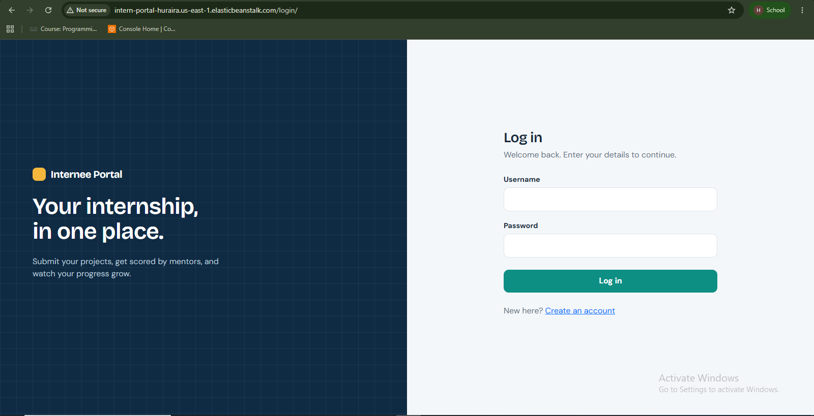

**Intern profile** (track, skills, bio, edit form)

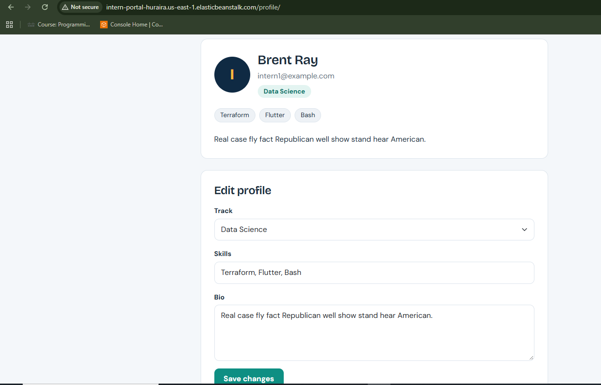

**My Projects** (submitted count, reviewed count, average score, reviewer feedback)

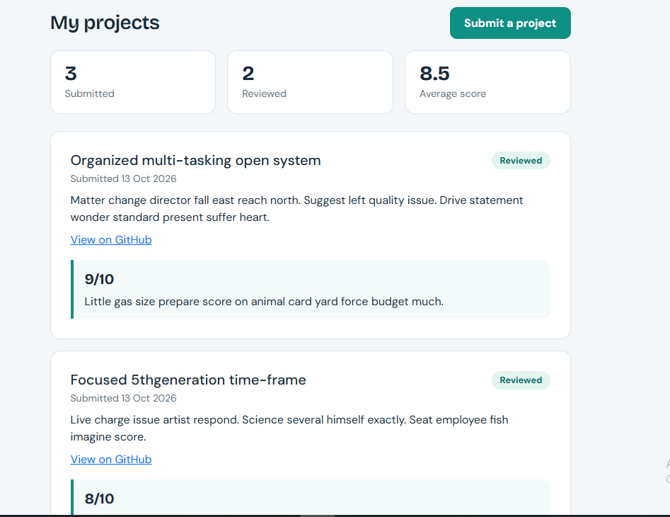

### Admin and seeded data

**Django admin: users.** Seeded interns (`intern1`, `intern2`, ...) stored in the cloud database.

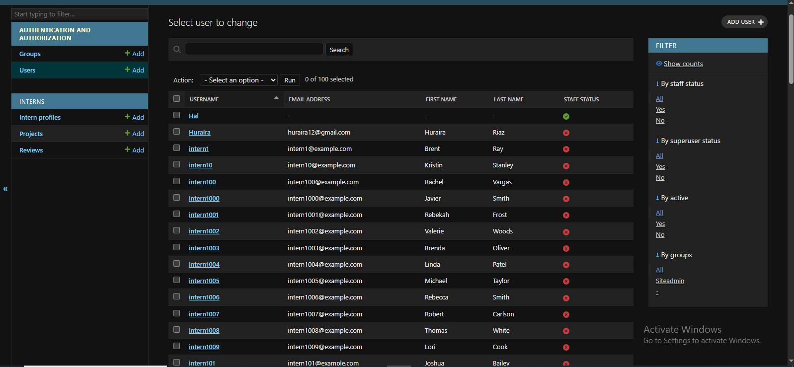

**Django admin: review.** A mentor score and feedback attached to a project.

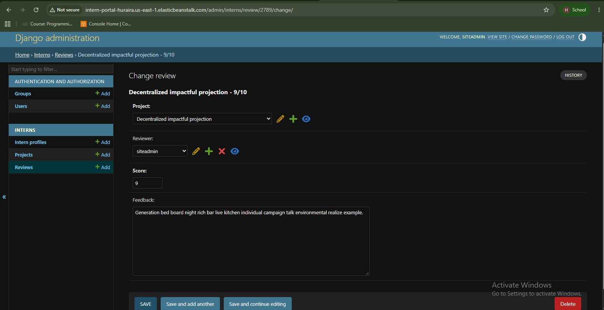

### AWS infrastructure

**Elastic Beanstalk environment** (health Ok, Python 3.12 on Amazon Linux 2023)

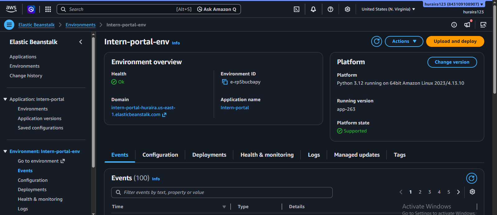

**Auto Scaling configuration** (load balanced, min 2 / max 4, CPU-based triggers)

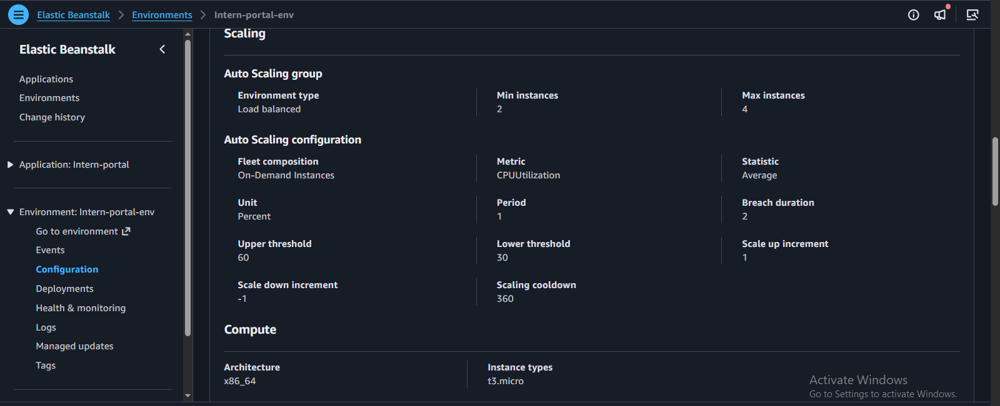

**Load balancer target group** (HTTP port 80, instance targets)

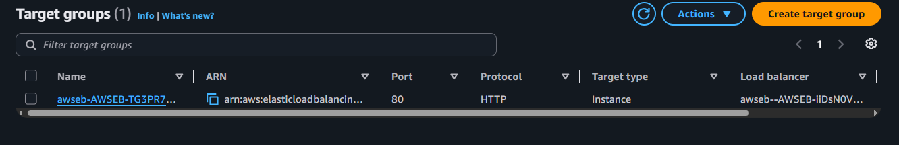

**RDS PostgreSQL database** (`intern-portal-db`, status Available)

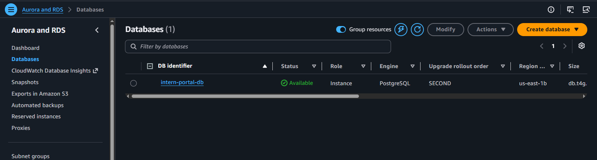

---

## Scalability

Auto Scaling is configured on the Elastic Beanstalk environment:

| Setting | Value |
|---|---|
| Environment type | Load balanced |
| Instances | Minimum 2, maximum 4 |
| Instance type | `t3.micro` (On-Demand) |
| Scaling metric | `CPUUtilization` (average, percent) |
| Scale up | When CPU is above 60%: add 1 instance |
| Scale down | When CPU is below 30%: remove 1 instance |
| Breach duration / cooldown | 2 minutes / 360 seconds |

Because every instance connects to one shared PostgreSQL database, any instance can serve any request and new instances join the load balancer without extra setup.

---

## Load test results

Tested with Locust against the deployed environment, using the seeded intern accounts.

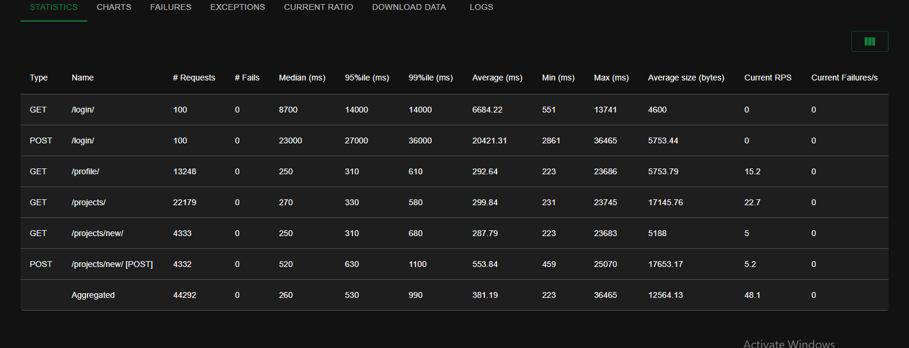

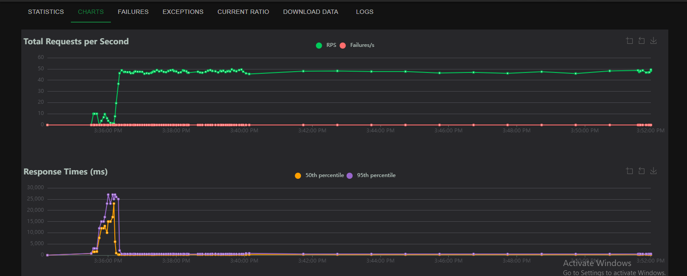

| Metric | Result |
|---|---|
| Total requests | 44,292 |
| Failed requests | **0** |
| Throughput | about 48 requests per second, sustained |
| Median response time | 260 ms |
| 95th percentile | 530 ms |
| 99th percentile | 990 ms |

**Observations**

- No request failed during the run.
- The charts show a response-time spike during the first minute while the simulated users ramped up and logged in. Login `POST` requests were the slowest (median about 23 s at the peak), because Django hashes passwords deliberately slowly and many logins arrived at once. After the ramp-up, response times stayed under about one second.
- Authenticated page requests (`/profile/`, `/projects/`, `/projects/new/`) stayed around 250 to 300 ms on average.

---

## Project structure

```
intern-portal/
├── portal/                 # Django project (settings, urls, wsgi)
├── interns/                # Main app: models, views, forms, admin
│   ├── models.py           # InternProfile, Project, Review
│   ├── migrations/
│   └── management/commands/seed_data.py
├── .ebextensions/
│   └── 01_django.config    # Runs migrate, collectstatic, admin + seed on deploy
├── Procfile                # gunicorn start command
├── requirements.txt
└── screenshots/            # Images used in this README
```

---

## Run locally

```bash
git clone <this-repo-url>
cd intern-portal
python -m venv venv
venv\Scripts\activate          # Windows (use source venv/bin/activate on Linux/macOS)
pip install -r requirements.txt
python manage.py migrate
python manage.py createsuperuser
python manage.py seed_data --users 1000      # optional demo data
python manage.py runserver
```

Without the `RDS_*` variables set, the app uses a local SQLite database.

### Demo data

```bash
python manage.py seed_data --users 2000
```

Creates fake interns (`intern1`, `intern2`, ...), profiles, 1 to 3 projects each, and reviews for about 70% of them. Seeded users share the default password `Intern@12345`, so use this for demos only.

---

## Deploying to AWS Elastic Beanstalk

1. **Create an RDS PostgreSQL instance** (single AZ, public access off). Set the *Initial database name* when you create it, or use the default `postgres` database.
2. **Create the database security group** so it allows port 5432 only from the Elastic Beanstalk instances' security group.
3. **Package the code from committed files** so nothing is missing:
   ```bash
   git archive --format=zip -o deploy.zip HEAD
   ```
4. **Create the Elastic Beanstalk environment** (Python 3.12 on Amazon Linux 2023, load balanced, min 2 / max 4 instances) and upload the ZIP.
5. **Set environment properties:**

   | Name | Purpose |
   |---|---|
   | `DJANGO_ENV` | `production` |
   | `DJANGO_SECRET_KEY` | Django secret key (generate a new one, never commit it) |
   | `RDS_HOSTNAME` | RDS endpoint |
   | `RDS_PORT` | `5432` |
   | `RDS_DB_NAME` | Database name |
   | `RDS_USERNAME` / `RDS_PASSWORD` | Database credentials |
   | `DJANGO_SUPERUSER_USERNAME`, `_EMAIL`, `_PASSWORD` | Used to create the admin user on first deploy |

6. **Deploy.** The `.ebextensions` config runs `migrate` and `collectstatic` on every deployment, and creates the admin user and seed data once.

---

## Problems solved during deployment

| Problem | Cause | Fix |
|---|---|---|
| Deployment package was missing config | `git archive HEAD` only includes committed files; `Procfile` and `.ebextensions` were not yet committed | Commit first, then build the ZIP, and verify it with `tar -tf deploy.zip` |
| Instances behaved inconsistently | Each instance had its own SQLite file | Moved to one shared RDS PostgreSQL database |
| `migrate` failed during deploy | `FATAL: database "portaldb" does not exist`; the initial database name was never set on RDS | Pointed `RDS_DB_NAME` at the default `postgres` database |
| Tables not created after changing settings | `container_commands` run only on a deployment, not on an environment-property change | Redeployed the application version |
| Health showed green while login and register failed | The load balancer health check only requests `/login/`, which does not query the database | Added Django error logging to read the real tracebacks; the health check page alone is not proof that the database works |
| Root cause hidden in logs | "Last 100 lines" logs omit `cfn-init-cmd.log` | Downloaded **Full logs** to read the real `migrate` error |

---

## Limitations and next steps

- The site is served over **HTTP only** (browser shows "Not secure"). A production setup would add an HTTPS listener on the load balancer with an ACM certificate and a custom domain.
- Uploaded files are not part of this version. For file storage, S3 would be the next addition.
- Scaling is CPU-based. A production setup could also scale on request count and add database read replicas or connection pooling.
- Seeded demo users share one known password and are not meant for production.

---

## Cleanup

To stop AWS charges after reviewing the project:

1. Terminate the Elastic Beanstalk environment (this removes the instances, load balancer and Auto Scaling group).
2. Delete the RDS instance (`intern-portal-db`), and skip the final snapshot if you do not need one.
3. Delete any unused security groups and application versions.
